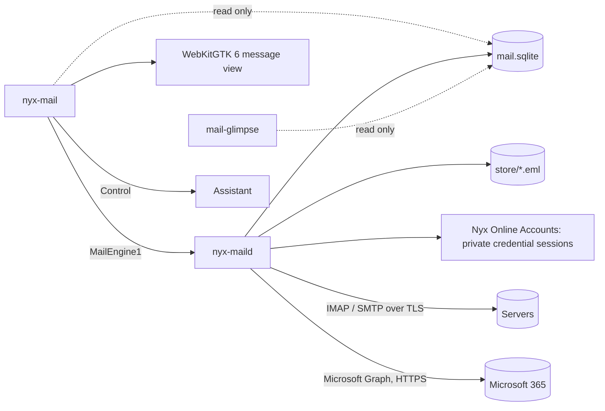

# Mail architecture

## Processes

- **`nyx-maild`** is GTK-free, runs as a systemd user unit (the `nyx-passwordsd`
  shape), and is the only writer of `mail.sqlite` and `store/`. It syncs, runs the ops
  queue, schedules snooze, send later and follow-ups, and sends notifications.
- **`nyx-mail`** is the window. It reads `mail.sqlite` read-only and asks the
  daemon to change anything over `io.github.design_nexus.nyx.MailEngine1`. If the
  daemon is down, cached mail stays readable and changes wait.

## Engine

| Need | Crate |
| --- | --- |
| IMAP | `async-imap` (rustls) |
| SMTP | `lettre` (rustls) |
| Microsoft Graph | `reqwest` (rustls) |
| MIME | `mail-parser`, `mail-builder` |
| HTML sanitizing | `ammonia` |
| Storage | `rusqlite` (bundled, FTS5) |
| Credentials | `nyx-accounts` (`credentials` feature) |
| Backoff | `nyx-sync::backoff` |

TLS is required. Accounts and their server settings come from Nyx Online Accounts (the
accounts with Mail turned on); credentials come from its private credential sessions:
XOAUTH2 with an access token for Google and personal Microsoft accounts, the account's
password otherwise. They're fetched for each connection and dropped. Microsoft 365 and
Outlook.com accounts have no IMAP settings and use Microsoft Graph with an access token
instead.

## Sync

- Message identity: `(account, mailbox, uidvalidity, uid)`; Gmail also `X-GM-MSGID` to
  merge All Mail copies; labels from `X-GM-LABELS`.
- CONDSTORE/QRESYNC when offered, otherwise UID and flag diffs. IDLE on Inbox.
- UIDVALIDITY change: drop that mailbox's rows and resync; raw messages are reused by hash.
- **Ops queue** (`ops` table): flag, move, copy, append, delete, send. Applied locally at
  once, replayed against the server with backoff. A server value that changed since the
  op was queued is a conflict: the server wins for flags, and moves of vanished messages
  are dropped and reported.
- Account removed in Online Accounts: sync stops; the UI offers to delete the local copy (Undo toast).

## Microsoft 365 (`graph`)

- Same rows as IMAP: each Graph folder is a mailbox (children named `Parent/Child`;
  Outbox, Sync Issues and Conversation History left out), roles from the well-known
  folders. Each message gets a UID here (`graph_items`, UIDVALIDITY 1); a folder whose
  Graph id changes starts over.
- Per folder, the delta query (`graph_folders.delta`) brings new and changed messages and
  removals. The first starts from the newest 500 (a `receivedDateTime` filter); an
  expired delta link (410) starts the folder over. Headers come from
  `internetMessageHeaders`, so sorting works as for IMAP; Outlook's conversation id
  threads. Bodies are MIME (`$value`).
- Ops: flags → PATCH `isRead`/`flag`, move → `/move`, delete for good →
  `/permanentDelete`. Sending posts the built MIME to `sendMail` with the Bcc header put
  back (Graph takes recipients from the headers); Outlook files it in Sent Items.
- No IDLE reaches a desktop: the engine polls every 3 minutes.
- Only links under the Graph base are followed, so the token goes nowhere else.

## Categories

The Screener and Imbox / Feed / Paper Trail are local metadata (`senders`, `rules`,
`message_category`), never folder moves, so switching back to folders loses nothing.
Feed uses `List-Id` / `List-Unsubscribe`; Paper Trail uses transactional senders and
receipt patterns; user rules win over both.

## Message view

WebKitGTK 6, used for message bodies only:

- HTML is sanitized with `ammonia`, then served from a custom `nyx-mail-msg:` scheme.
- JavaScript, plugins, navigation and every http/https load are off. Images load only
  when allowed for that sender or message. `cid:` parts come from the store.
- Links open in the system browser after showing the real target.
- Theme tokens are injected as CSS. Plain text renders natively.

## Control tools

Reads: `mail.search`, `mail.read`, `mail.summarize`, `mail.important`. Edits:
`mail.draft`, `mail.categorize`. `mail.send` always needs a key press in Assistant and
is not voice-approvable. Mail content is returned with `untrusted_content: true`.
